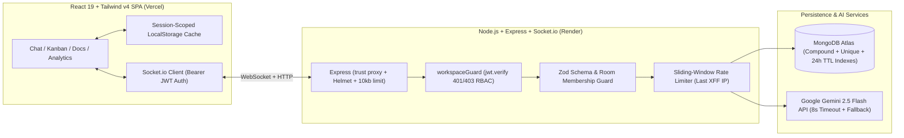

# TeamSync AI — Real-Time Collaborative Engineering Workspace

/actions/workflows/ci.yml/badge.svg)


A full-stack collaborative workspace for software teams combining **Socket.io room-isolated messaging**, a **drag-and-drop Kanban sprint board**, an **800ms debounced collaborative markdown/code editor**, **signed JWT Role-Based Access Control (RBAC)**, and **rate-limited Google Gemini 2.5 Flash sprint automation**.

- **Live Application (Vercel):** https://teamsync-workspace-three.vercel.app
- **Backend Health Probe (Render):** https://[teamsync-ai.onrender.com/api/health](https://teamsync-ai.onrender.com/api/health)
  *(Note: Hosted on Render free tier — the first request after inactivity may take ~25–40s to wake the container. Meanwhile, the client serves an instant session-scoped local cache and displays a warming banner.)*

---

## Tech Stack

- **Frontend:** React 19, Vite, Tailwind CSS v4, Socket.io-Client
- **Backend:** Node.js (>=20), Express.js, Socket.io, Mongoose (MongoDB Atlas), JSON Web Token (`jsonwebtoken`), Zod (`zod`), Helmet
- **AI Integration:** Google Generative AI SDK (`@google/generative-ai` — `gemini-2.5-flash`) with an automatic deterministic fallback template engine
- **Testing & CI:** Native Node.js Test Runner (`node:test`), GitHub Actions CI (`.github/workflows/ci.yml`)

---

## System Architecture



---

## Architecture Decision Records (ADR)

### 1. Signed JWT RBAC & Demo Token Issuance (`backend/middleware/workspaceGuard.js`)
- **How Demo Roles Work:** Because this is a frictionless portfolio demo without a registration wall, demo roles (`Tech Lead` vs `Developer`) are issued via `POST /api/auth/demo-token` without password credentials; production deployments bind this token issuer to standard OAuth/password authentication.
- **Server-Side Enforcement:** Once issued, the token is signed with `JWT_SECRET` (`HS256`) and verified via `jwt.verify()` on both REST routes (`workspaceGuard`) and Socket.io events (`verifySocketAction`). Missing/invalid tokens return **`401 Unauthorized`**, and `Developer` tokens attempting `Tech Lead` actions (`/plan`, `delete_task`) return **`403 Forbidden`**.
- **Sender & Room Membership Verification:** Every Socket.io mutation checks `socket.rooms.has(room)` before processing and binds the `sender` field directly from the verified JWT (`socket.user.username`) to prevent sender spoofing.

### 2. Session-Scoped Sandbox Isolation & 24h TTL Cleanup
- Every browser generates a session key (`sess_<id>`), scoping Socket.io rooms as `sess_<id>:general` and hydrating state via `GET /api/messages/:room`, `/api/tasks/:room`, and `/api/docs/:room`.
- Opening two tabs in the same browser shares `sess_<id>`, synchronizing messages, polls, reactions, pins, new/updated/deleted Kanban tasks, and collaborative docs in real time.
- All three Mongoose models (`Message`, `Task`, `Document`) include a 24-hour TTL index (`expireAfterSeconds: 86400`) to purge expired demo sessions automatically.

### 3. Anti-Spoofing Rate Limiter & Duplicate-Preventing Sprint Planning
- `extractClientIp()` reads the rightmost hop of `x-forwarded-for` (appended by Render's reverse proxy) so clients cannot spoof leading XFF headers to bypass the **5 requests/min** AI rate limit.
- Repeated `/plan` commands are deduplicated both in memory (`deduplicatePlanTasks`) and at the database level via a unique compound index `{ room: 1, normalizedTitle: 1 }`.

---

## Local Setup & Installation

```bash
git clone https://[github.com/farukaydinn96-commits/teamsync-ai](https://github.com/farukaydinn96-commits/teamsync-ai).git
cd teamsync-ai

cp backend/.env.example backend/.env
cd backend && npm install
npm run dev

cp frontend/.env.example frontend/.env
cd ../frontend && npm install
npm run dev
```

---

## Automated Tests

```bash
npm --prefix backend test
```

---

## Known Limitations & Roadmap

- **Demo Role Issuance:** Demo roles are selectable without password login so reviewers can test `401`/`403` RBAC transitions immediately.
- **Seeded Baseline Tasks:** Initial seed items (`seed-*`) reside in the client baseline until new tasks or messages are created in the session room.
- **Document Concurrency (Last-Write-Wins):** Simultaneous edits within the 800ms debounce window resolve via Last-Write-Wins with a monotonic `version` counter rather than full CRDT/Yjs.
- **Latency Badge:** The `Live (ms)` indicator measures HTTP round-trip time against `GET /api/health`.
